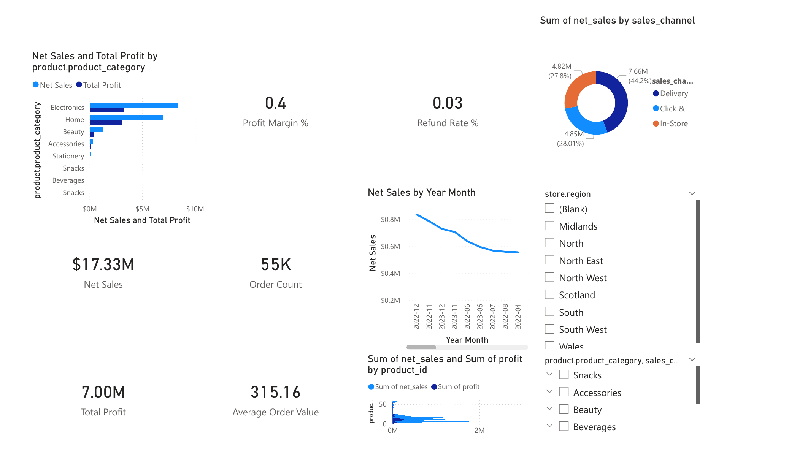
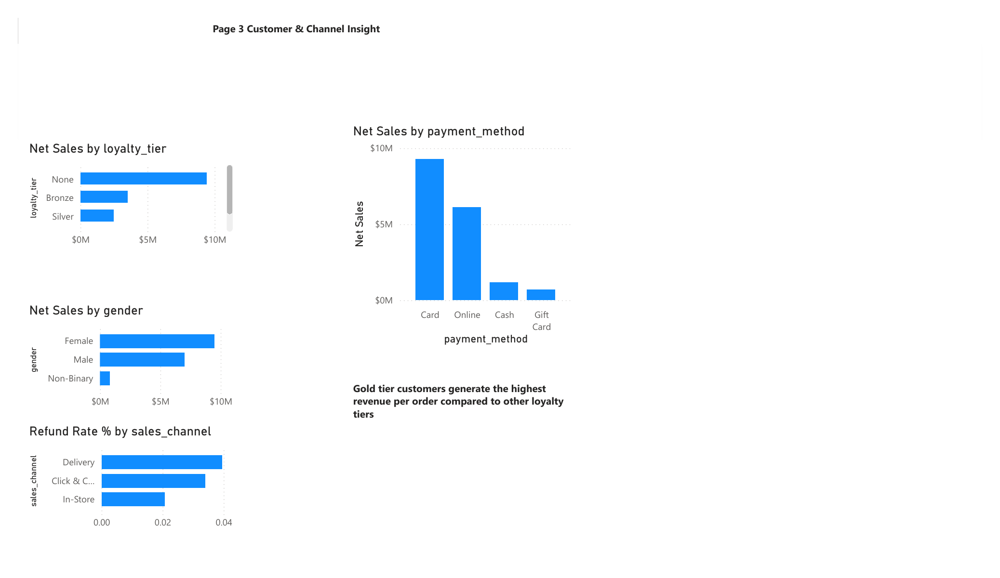
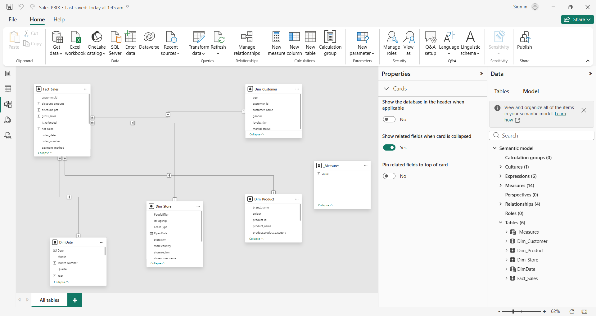

# Retail Sales Analytics Dashboard — Power BI


A 4-page Power BI report that analyses **$17.33M in net sales across 55K orders (2021–2023)** for a multi-channel retailer, built on a star-schema data model with 14 DAX measures. The report surfaces where profit comes from, how channels and payment methods compare, and which data-quality issues managers should know about.

**Author:** Krushal Sardhara · Lambton College, AI & ML program · April 2026 · individual project

---

## Dashboard preview

**Executive summary** — KPIs, sales trend, channel split and slicers for year, region, category and channel



**Customer & channel insight** — loyalty tier, gender, payment method and refund rate by channel



## Data model

A star schema with `Fact_Sales` at the centre and one-to-many, single-direction relationships from each dimension. `DimDate` is marked as the date table so time-intelligence measures (prior year, YoY growth) work.



| Table | Type | Example columns |
| --- | --- | --- |
| `Fact_Sales` | Fact | order_number, order_date, customer_id, gross_sales, discount_amount, net_sales, is_refunded, payment_method |
| `Dim_Customer` | Dimension | customer_id, age, gender, loyalty_tier, marital_status |
| `Dim_Product` | Dimension | product_id, product_name, brand_name, product_category, colour |
| `Dim_Store` | Dimension | store_name, city, region, country, flagship flag, footfall tier |
| `DimDate` | Dimension (date table) | Date, Year, Quarter, Month, Month Number |

## DAX measures

All 14 measures live in a dedicated `_Measures` table.

| Sales | Profit & cost | Discounts & refunds | Orders & time |
| --- | --- | --- | --- |
| Net Sales | Total Cost | Discount Amount | Order Count |
| Gross Sales | Total Profit | Discount Rate % | Average Order Value |
| Quantity Sold | Profit Margin % | Refund Order Count | Net Sales PY |
| | | Refund Rate % | YoY Sales Growth % |

## Report pages

| Page | Purpose |
| --- | --- |
| 1. Executive Summary | Net Sales, Profit Margin, Order Count and Average Order Value with a monthly trend, sales by channel and interactive slicers |
| 2. Product & Store Performance | Ranks stores and products by sales and profit; store × category matrix; decomposition tree by region and category |
| 3. Customer & Channel Insight | Loyalty tier, gender, payment method and refund rate by channel |
| 4. Insights & Recommendations | Six findings, three recommendations and a data-quality caveat |

## Key findings

1. **$17.33M net sales and $7.00M profit** across 2021–2023 — a **40% profit margin**.
2. **Average order value is $315.16** across 55K+ orders.
3. **Card payments drive about $10M** of net sales, followed by Online, then Cash and Gift Card.
4. **Delivery has the highest refund rate (~4%)**, about double In-Store (~2%), pointing to possible fulfilment or quality issues.
5. **Customers with no loyalty tier ("None") generate the most sales**, which suggests a large unregistered customer base.
6. **Electronics and Home** lead net sales and profit by product category.

## Recommendations

- Run a loyalty enrolment campaign at checkout for "None"-tier customers to improve retention and enable personalised marketing.
- Audit the Delivery channel (packaging, delivery-partner SLAs, product checks) to bring its refund rate down.
- Focus marketing on Card and Online customers, the highest-revenue segments.

## Data-quality notes

- Many customers have **no loyalty tier**, which understates the named tiers (Bronze, Silver, Gold) in comparisons.
- Some transactions show a **blank store name** because their store IDs don't match `Dim_Store`, which affects store rankings.

## Tools

Power BI Desktop · DAX · star-schema data modelling

## Repository contents

```
retail-sales-powerbi-dashboard/
├── images/
│   ├── 01_executive_summary.png
│   ├── 02_customer_channel_insight.png
│   └── 03_star_schema_model.png
└── README.md
```
